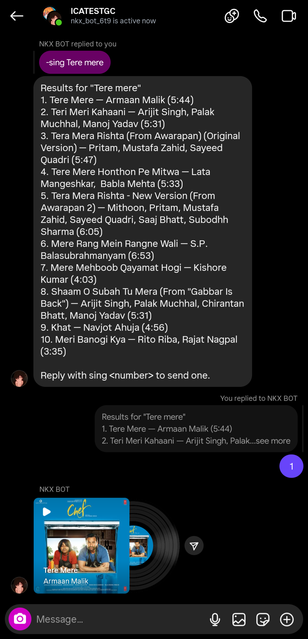
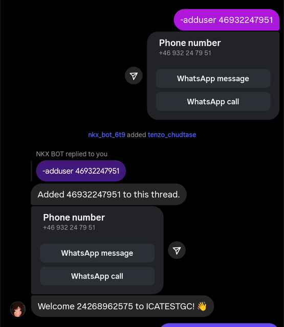
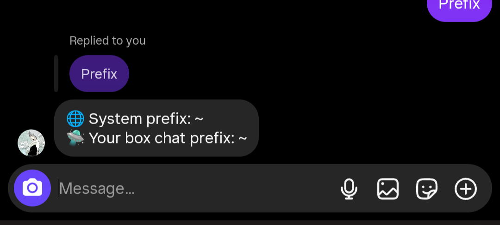

<div align="center">


<br/>

An <b>Instagram Direct</b> chat bot built on
<a href="https://www.npmjs.com/package/@lazyneoaz/ig-chat-api"><code>@lazyneoaz/ig-chat-api</code></a>,
an unofficial Instagram Direct API client whose public surface mirrors
<code>fb-chat-api</code> and runs against a hosted ig-chat-api server.

<br/><br/>

<a href="https://github.com/lazyneoaz/Insta-Bot/stargazers"></a>
<a href="https://github.com/lazyneoaz/Insta-Bot/network/members"></a>
<a href="https://github.com/lazyneoaz/Insta-Bot/watchers"></a>
<a href="https://github.com/lazyneoaz/Insta-Bot/issues"></a>
<a href="https://github.com/lazyneoaz/Insta-Bot/commits/main"></a>


<br/>


<a href="./LICENSE"></a>

</div>

---

> The Messenger original, [Goat-Bot-V2](https://github.com/ntkhang03/Goat-Bot-V2),
> is by **NTKhang**. This **Instagram edition** is by
> **lazyneoaz — Saifullah Al Neoaz** ([@lazyneoaz](https://github.com/lazyneoaz)),
> forked from NTKhang's GoatBot repo and adapted to run on a personal Instagram
> account instead of Facebook Messenger. The bot logic (command handler, event
> handler, database, dashboard) is unchanged; only the engine was swapped from
> Facebook to Instagram and every `fb-chat-api` call was repointed at the
> Instagram client.

## 📸 Screenshots

<div align="center">

|  |  |
|:---:|:---:|
| **Uptime &amp; system dashboard** — live process stats, host resources, Node version | **Music search** — find a track and send it as a sticker |
|  |  |
| **Group events** — welcome / leave logs and admin actions | **Prefix info** — per-thread command prefix, replies in place |

</div>

## 📝 Note

- This bot uses a **personal Instagram account** and the unofficial Instagram
  Direct API client. Automated use can get the account flagged or locked, so use a
  throwaway/clone account.
- **I am not responsible for any problem that may arise from using this bot.**

## 🚧 Requirements

- **Node.js >= 18**. The realtime DGW web socket uses the built-in global
  `WebSocket` on Node >= 22, and falls back to the `ws` package on older
  runtimes; if neither is available it falls back to the Android `/lightspeed`
  stream, so realtime still works.
- An Instagram account whose session cookies you can export (browser
  Cookie-Editor, or an existing appState JSON).

## 📦 Install

```bash
git clone https://github.com/lazyneoaz/Insta-Bot.git goatbot-ig
cd goatbot-ig
npm install
```

The Instagram client is a normal npm dependency
(`"@lazyneoaz/ig-chat-api": "^0.0.1"`); `npm install` fetches it, so no extra
step is needed.

## 🔑 Session

The bot reads the login session from `account.txt` in the project root
(gitignored). Any of these formats works:

- a fb-chat-api / GoatBot **appState array** — `[{ "key": "sessionid", "value": "..." }, ...]`
- a raw browser **Cookie-Editor export** — `[{ "name": "sessionid", "value": "..." }, ...]`
- a **Netscape cookies.txt** file
- a plain cookie **header string** — `sessionid=...; ds_user_id=...; csrftoken=...`

The array must contain at least `sessionid` and `ds_user_id`. `csrftoken` is
recommended.

## ▶️ Run

```bash
node index.js
```

`index.js` supervises `Goat.js` and restarts it on exit code `2` (the code the
bot uses for "restart"). On success you should see:

```
LOGIN INSTAGRAM: Successful login
BOT_STARTED: Bot has been started successfully, start receiving messages from users
```

Then send the prefix (default `-`) followed by a command in an Instagram DM.

> **Hosting note:** on managed hosts (Render, Railway, Heroku) the dashboard and
> the uptime server bind the port assigned in `$PORT`, falling back to
> `config.json` when it is unset — so the service passes the host health check and
> is not restarted.

## 💡 How it works

- `bot/login/login.js` reads `account.txt`, calls the client's
  `login({ appState }, optionsFca, cb)` and starts `api.listenMqtt(callback)`.
- The client connects to the hosted ig-chat-api server, which holds the
  Instagram session and normalises Instagram Direct messages into the same
  event shape `fb-chat-api` emits (`type`, `senderID`, `threadID`, `messageID`,
  `body`, `attachments`, `mentions`, `timestamp`, ...), so `handlerEvents` and
  every script work unchanged.
- `handlerEvents` routes the event to commands/events (`onStart`, `onChat`,
  `onFirstChat`, `onReply`, `onReaction`, `onEvent`, `handlerEvent`). These work
  exactly as documented upstream.

## ⚙️ Configuration

`config.json` holds the bot settings. The Instagram-specific parts:

- `instagramAccount.userAgent` / `instagramAccount.proxy` — legacy Instagram
  HTTP settings; the hosted client ignores them (the server owns the request
  fingerprint and proxy), kept only for backwards compatibility.
- `optionsFca` — the options passed to the client's `login()`
  (`listenEvents`, `updatePresence`, `listenTyping`, `selfListen`,
  `selfListenEvent`, `autoMarkDelivery`, `autoReconnect`, `forceLogin`,
  `logLevel`, plus the keep-alive / token-refresh knobs `keepAliveInterval`,
  `tokenRefreshInterval`, `realtimeKeepAlive`). Engine-internal keys (`proxy`,
  `dgwHost`, `userAgent`, ...) are server-owned and ignored by the hosted client.
  See the [client docs](https://www.npmjs.com/package/@lazyneoaz/ig-chat-api)
  for the full list.
- `autoRefreshSession` — when `true`, the refreshed cookies returned by the
  client are written back to `account.txt` so the session does not go stale.
- `gbanCheck` — **disabled by default**. The upstream GBAN list is keyed by
  Facebook numeric uids; an Instagram id can collide with one of them, and the
  check exits the bot hard when GitHub is unreachable. Enable it only if you
  know what you are doing.

- `customFeatures` — two **admin-only** quality-of-life switches (both off by
  default):

  - **`unsendOnReaction`** — when a bot admin reacts to a message the bot sent
    with one of the configured emojis (default 😠 / 😡), the bot unsends that
    message. Works on any message the bot sent (command replies, random sends,
    game prompts). Configure the trigger emojis in
    `customFeatures.unsendOnReaction.reactions`, or toggle it with
    `-unsendonreaction [on | off | status]`.
  - **`noPrefix`** — lets a **bot admin** run a command by sending its exact
    name or alias with no prefix (e.g. `help` instead of `-help`). Normal chat is
    never treated as a command: a message only runs when its first word exactly
    matches a command name or alias, so `hello how are you` is ignored. Toggle it
    with `-noprefix [on | off | status]`. Non-admins always need the prefix.

Google credentials (`config.json` → `credentials.gmailAccount`,
`credentials.gRecaptcha`) are **optional**: Gmail notifications / dashboard OTP
and Google Drive upload are disabled when they are empty or absent, and the bot
still starts and serves chat commands.

The `.dev` variants (`config.dev.json`, `configCommands.dev.json`,
`account.dev.txt`, `*.dev.js`) are **optional** too. When `NODE_ENV` is
`production` or `development` the `.dev` file is used if it exists, otherwise
the bot falls back to the regular file instead of refusing to start.

Everything else (database, dashboard, languages, `configCommands.json`) is
unchanged from Goat-Bot-V2.

## 🛠️ Creating commands

Same as upstream — see [DOCS.md](./DOCS.md) and the commented examples in
`scripts/cmds/newcommand.eg.js` / `scripts/events/newcommandevent.eg.js`. Any
`fb-chat-api` method you know (`api.sendMessage`, `api.changeNickname`,
`api.sendAttachment`, ...) is available through the client, and the client docs
list exactly which ones exist and which Instagram lacks.

## 📚 The client

`@lazyneoaz/ig-chat-api` is installed from npm
(https://www.npmjs.com/package/@lazyneoaz/ig-chat-api). It is a thin client for
the hosted ig-chat-api server: it supports both callback and promise style for
every method, exposes the realtime (`listenMqtt`) event stream, and needs no
local Instagram protocol code. Install it with the project (`npm install`) or on
its own (`npm install @lazyneoaz/ig-chat-api`).

## ✨ Credits

- **NTKhang** (https://github.com/ntkhang03) — the original Goat-Bot-V2, the
  Messenger bot this project is forked from.
- **lazyneoaz — Saifullah Al Neoaz** (https://github.com/lazyneoaz) — the
  Instagram edition (GoatBot IG) and the `@lazyneoaz/ig-chat-api` client.

## 📜 License

MIT — see [LICENSE](./LICENSE).

<div align="center"><br/>

Made with ❤️ by <a href="https://github.com/lazyneoaz">lazyneoaz — Saifullah Al Neoaz</a>

<br/>

⭐ If this project helps you, consider giving it a star!

</div>
